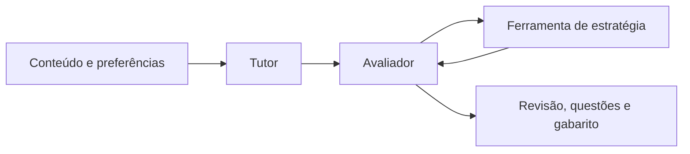

# Multi-Agent Study Assistant

Assistente de revisão de estudos desenvolvido em **Python, LangGraph e LangChain**, com dois agentes que colaboram para produzir **revisões teóricas, questões e gabaritos** personalizados a partir do conteúdo informado pelo usuário.

O projeto utiliza **LLMs via Groq**, um fluxo multiagente explícito e uma ferramenta para configurar as regras de avaliação. A organização atual transforma o notebook acadêmico original em uma aplicação Python convencional, modular e executável pelo terminal.

## Funcionalidades

- Analisa o conteúdo informado e sugere tópicos prioritários e focos adequados.
- Personaliza **prioridade**, **foco**, **profundidade** e **tamanho** da revisão.
- O **Tutor** cria uma revisão objetiva; o **Avaliador** usa a revisão para gerar questões.
- O Avaliador invoca uma ferramenta que define a quantidade, tipo e dificuldade das questões.
- Apresenta questões de múltipla escolha e abertas e oculta o gabarito até a confirmação do usuário.
- Não armazena histórico persistente entre execuções.

## Arquitetura



A análise inicial das opções reutiliza o LLM do Tutor, **sem criar outro agente**. O grafo usa `StateGraph`, `MessagesState`, `ToolNode` e `tools_condition`.

Detalhes da arquitetura e das decisões técnicas estão em [docs/architecture.md](docs/architecture.md).

## Tecnologias

- Python 3.10+
- LangGraph e LangChain
- Groq API (`langchain-groq`)
- Modelo configurado: `openai/gpt-oss-20b`

## Executar

1. Clone o repositório:

   ```bash
   git clone https://github.com/lanamiranda17/multi-agent-study-assistant.git
   cd multi-agent-study-assistant
   ```

2. Crie um ambiente virtual e instale as dependências:

   ```bash
   python -m venv .venv
   source .venv/bin/activate  # Linux/macOS
   pip install -r requirements.txt
   ```

   No Windows, ative com `.venv\\Scripts\\activate`.

3. Configure a chave da Groq na variável de ambiente `GROQ_API_KEY` ou informe-a quando o programa solicitar. **Nunca versione uma chave real.**

4. Execute:

   ```bash
   python main.py
   ```

O programa solicitará o conteúdo estudado, apresentará prioridades e focos sugeridos pelo modelo, pedirá as preferências e exibirá a revisão e as questões. O gabarito só será exibido após confirmação.

## Testes

```bash
python -m unittest discover -s tests -v
```

Os testes unitários verificam validação de opções, seleção no menu, estratégia de avaliação e separação de questões/gabarito. **Não são testes de integração com a Groq**, portanto não garantem o comportamento da LLM em produção.

## Estrutura

```text
multi-agent-study-assistant/
├── main.py                    # Interface de terminal
├── src/
│   ├── agents.py              # Tutor e Avaliador
│   ├── graph.py               # Fluxo LangGraph
│   ├── tools.py               # Ferramenta de avaliação
│   ├── strategy.py            # Regras determinísticas
│   ├── preferences.py         # Sugestões de tópicos e focos
│   ├── review.py              # Execução e processamento da resposta
│   └── settings.py            # Configuração do modelo e da API
├── tests/                     # Testes unitários
├── docs/                      # Arquitetura e decisões técnicas
├── requirements.txt
└── .env.example
```

## Limitações

O sistema depende de acesso à API Groq. As respostas dos modelos podem conter imprecisões ou formato inesperado. Não há memória persistente nem correção automática das respostas do estudante.

## Autoria e contexto acadêmico

Desenvolvido em colaboração por **[Lana da Silva Miranda](https://github.com/lanamiranda17)** e **[Caio Bueno Finocchio Martins](https://github.com/CaioBFM)**, na disciplina **GCC128 - Inteligência Artificial**, da Universidade Federal de Lavras (UFLA), ministrada pelo professor Ahmed Ali Abdalla Esmin.

A implementação acadêmica original está disponível no [repositório Trabalhos — IA](https://github.com/CaioBFM/Trabalhos---IA/tree/main/agentes-inteligentes).
