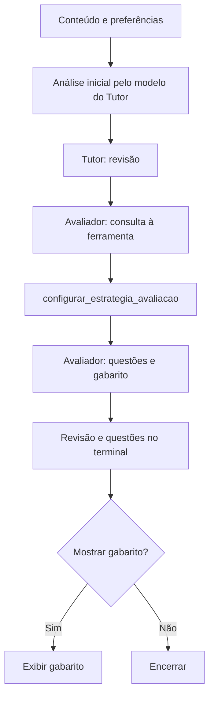

# Arquitetura multiagente

## Visão geral

O projeto é uma aplicação Python modular executada pelo terminal. O fluxo multiagente possui **dois agentes LLM** com funções distintas:

- **Tutor:** redige uma revisão teórica do conteúdo enviado.
- **Avaliador:** recebe a revisão do Tutor e produz questões e gabarito após consultar uma ferramenta de estratégia.

A seleção de prioridades e focos ocorre **antes** do grafo: uma chamada ao modelo do Tutor examina o texto e devolve JSON com sugestões. Esse pré-processamento mantém a análise de opções separada do fluxo principal, sem introduzir um terceiro agente.

## Estado do grafo

O grafo é montado em `src/graph.py` com `StateGraph(MessagesState)`. Os nós retornam mensagens, e `ToolNode` executa a ferramenta. `tools_condition` envia o fluxo ao nó de ferramentas quando o Avaliador solicita uma chamada, ou encerra quando há resposta final. O retorno da ferramenta leva o controle novamente ao Avaliador.

O fluxo é deliberadamente fixo: o Tutor sempre produz a revisão e o Avaliador sempre produz a avaliação. Por isso, não há necessidade de um Supervisor para decidir qual agente deve atuar; o encadeamento explícito torna as responsabilidades e as transições previsíveis.

Cada chamada usa um novo `MessagesState`. **Não há `checkpointer`, memória persistente ou reaproveitamento de conversas**. Cada execução é independente, o que evita que conteúdos e preferências de uma sessão influenciem outra.

## Estratégia de avaliação

`src/tools.py` define a quantidade e distribuição de questões:

| Profundidade | Múltipla escolha | Abertas | Dificuldade |
| --- | ---: | ---: | --- |
| Básica | 4 | 1 | Baixa |
| Intermediária | 3 | 2 | Média |
| Avançada | 2 | 3 | Alta |

O foco determina a abordagem pedagógica. A prioridade determina os assuntos mais cobrados, não a distribuição de tipos de questões. A ferramenta é executada por `ToolNode` quando solicitada pelo Avaliador e foi mantida como regra explícita e determinística, em vez de ser substituída por instruções puramente textuais.

## Entradas e saídas

O programa recebe conteúdo livre, prioridade, foco, profundidade e tamanho. A resposta final do Avaliador usa as tags `QUESTOES` e `GABARITO`, tratadas pelo parser em `src/review.py`. `main.py` coordena a interação no terminal; `src/preferences.py` valida as sugestões; `src/strategy.py` concentra as regras determinísticas; e `src/settings.py` configura o acesso aos modelos.

A interface exibe as questões primeiro e o gabarito somente após a confirmação do usuário, mantendo a separação entre conteúdo para estudo e respostas.

## Decisões técnicas

- **Dois agentes:** a análise inicial reutiliza o modelo do Tutor; o Tutor redige a revisão e o Avaliador cria as questões.
- **Supervisor:** não é utilizado porque a sequência de tarefas é fixa e não exige roteamento dinâmico.
- **Memória persistente:** não é utilizada; o estado existe apenas durante a execução corrente.
- **Ferramenta do LangGraph:** somente o Avaliador recebe `configurar_estrategia_avaliacao`, pois apenas ele precisa definir quantidade, tipos e dificuldade das questões.
- **Preferências:** prioridade, foco, profundidade e tamanho têm responsabilidades independentes e são validados antes da execução do grafo.

## Contexto acadêmico e autoria

Esta aplicação foi desenvolvida a partir do projeto acadêmico original, realizado em colaboração por **[Lana da Silva Miranda](https://github.com/lanamiranda17)** e **[Caio Bueno Finocchio Martins](https://github.com/CaioBFM)** na disciplina GCC128 — Inteligência Artificial, da Universidade Federal de Lavras (UFLA), ministrada pelo professor Ahmed Ali Abdalla Esmin. O projeto original está disponível no [repositório Trabalhos — IA](https://github.com/CaioBFM/Trabalhos---IA/tree/main/agentes-inteligentes).
